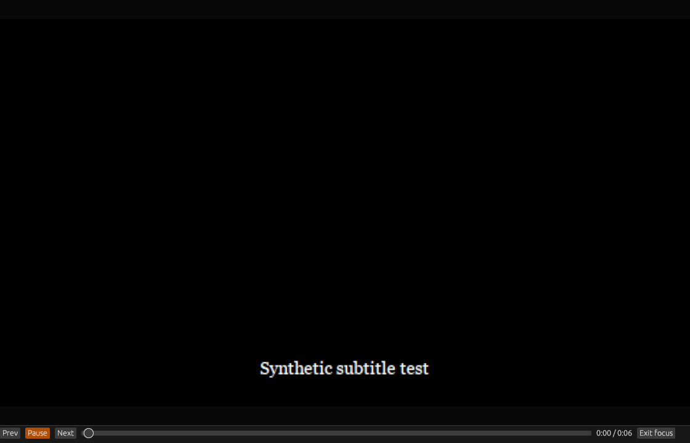
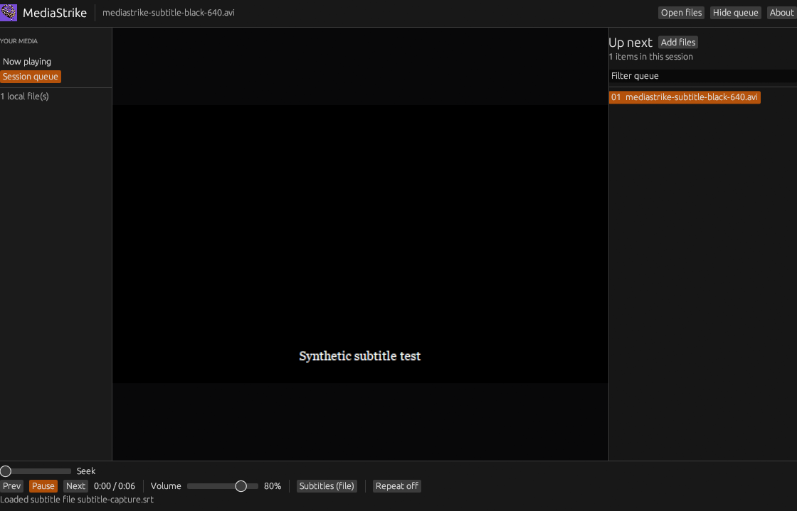
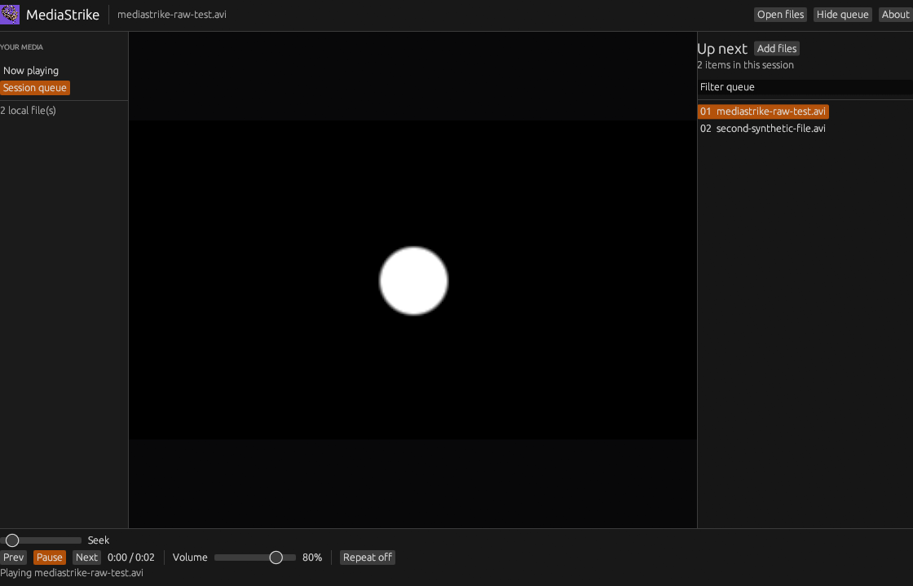
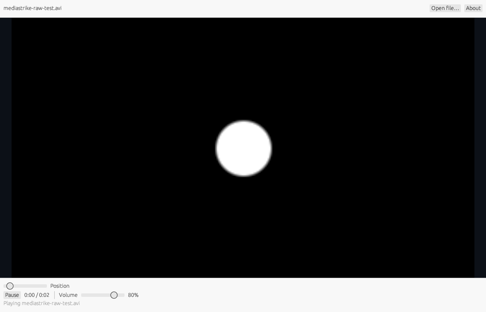
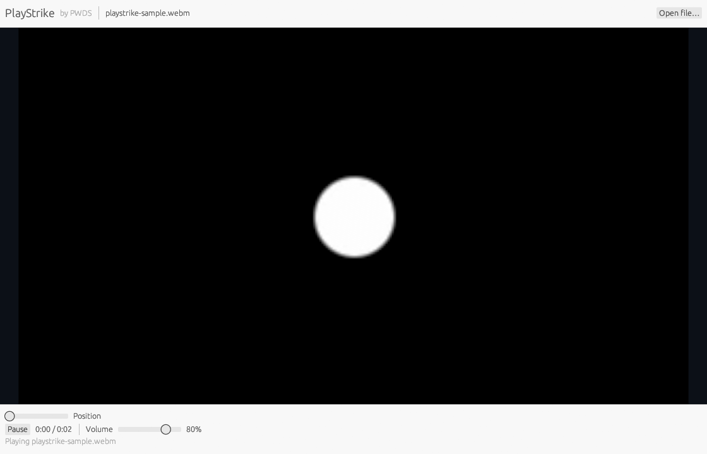

<p align="center">
  
</p>

<p align="center">
  <a href="https://prowebdevsolutions.com"><picture>
    <source media="(prefers-color-scheme: dark)" srcset="assets/branding/PWDS-logo-orange.svg">
    
  </picture></a>
</p>
<p align="center"><strong>Published by PWDS</strong></p>

<h1 align="center">MediaStrike</h1>

**Press play on media you already have.** MediaStrike is a focused Windows desktop player for local video and audio files. Open a file, drop it into the window, or pass its path when launching.

[How to run](#run-from-source) · [Verification](VERIFY.md) · [Original artwork](assets/branding)

## Player preview

### Video-focused player view



The [source-matched focus capture](docs/FOCUS_VIEW_FINAL_CAPTURE_PROVENANCE.md) shows the video using the window width with a full-width seek track in one transport row. The matching [normal-view capture](assets/screenshots/mediastrike-normal-1517f4a.png) shows the rails before focus mode. Both use synthetic local media and the same hosted Windows executable. Native F11 and button clicks still need hands-on review. The [first focus capture](docs/FOCUS_VIEW_CAPTURE_PROVENANCE.md) remains for comparison.

### MediaStrike subtitle preview



These [fresh native renderer captures](docs/SUBTITLE_FINAL_CAPTURE_PROVENANCE.md) show visible [SRT](assets/screenshots/mediastrike-subtitles-srt-c48564e.png) and [WebVTT](assets/screenshots/mediastrike-subtitles-vtt-c48564e.png) captions from the verified follow-up source using synthetic local files. [Hosted follow-up tests](docs/SUBTITLE_FOLLOWUP_VERIFICATION.md) cover two embedded tracks, switching and Off, file choice while playing or paused, malformed files, Repeat one, and newer choices during a pending file load. Native menu clicks still need hands-on review; the [earlier captures](docs/SUBTITLE_CAPTURE_PROVENANCE.md) remain preserved.

### MediaStrike queue layout draft



This [earlier native renderer capture](docs/QUEUE_CAPTURE_PROVENANCE.md) shows the queue branch with two local files in its session queue. It verifies the visible layout and one decoded frame; hands-on transport and queue interaction still need review.

### Earlier MediaStrike draft interface



This [earlier app-rendered capture](docs/MEDIASTRIKE_CAPTURE_PROVENANCE.md) comes from the MediaStrike rename branch at commit `092da379`. It shows a decoded synthetic video frame before the queue layout.

### Historical PlayStrike interface



The [earlier PlayStrike capture](docs/SCREENSHOT_PROVENANCE.md) remains here for comparison.

## The player

### Open a local file your way

Use the multi-file picker, drag and drop, or launch paths. The player reports an error when a file cannot be opened. It does not bundle an account, cloud service, or codec pack.

### Keep a session queue

Add more local files without interrupting playback, select a queued file, filter the queue by filename, and use previous/next and repeat controls. The queue holds up to 1,000 entries and lasts for this session only. Saved playlists, a scanned media library, and broader VLC features remain future work; see the [feature coverage map](docs/VLC_PARITY.md).

### Stay in control of playback

Play and pause, seek with the bar or five-second steps, adjust volume, use **Mute**, and cycle the **Speed** button through 0.5×, 1×, 1.5×, and 2× in either player view. Playback speed carries into the next queued file and a loaded subtitle. A file that rejects the selected speed continues at 1× with a visible error. Muting keeps the selected volume and continues across queued files and subtitle changes; moving the volume slider unmutes. Keyboard shortcuts include **Space** for play/pause, **M** for mute, **Left/Right** for seeking, **Alt+Left/Right** for previous/next file, and **Ctrl+O** for the file picker. The seek bar commits its new position when released.

Use **F11** or **Focus view** to expand the video and keep a compact playback row. **Exit focus** or F11 restores the regular player and its queue visibility. Launch a video directly in that view with `--focus-view` after a media path.

### Choose local subtitles

Open the **Subtitles** menu in the transport rail to turn captions off, choose a discovered text track, or load a local `.srt` or `.vtt` file for the current media. Loading a file prepares a replacement player while the current one continues, then restores its playback position and pause state before switching. An invalid file keeps the current player. Track availability depends on GStreamer plugins and the file; the menu reports unsupported extensions, missing files, and selection errors. For a launch-time subtitle, use `--subtitle path\to\captions.srt` after the media path. The file applies to the first opened item, not every item in the session queue. Subtitle styling, offset adjustment, and saved associations remain future work.

### Decode with the installed GStreamer runtime

GStreamer supplies decoding and playback. Format support depends on the installed plugins and their licenses. The current video path copies decoded RGBA frames into an egui texture and limits preview to 4096×2160; CPU and memory costs for large videos still need measurement. Hardware decoding may be chosen by GStreamer, but presentation is not zero-copy.

## Run from source

Install a Rust toolchain that supports edition 2024 and a **GStreamer 1.0 MSVC x86_64 development SDK**, including the runtime and plugins needed for your media. If installed at the path below, run this in PowerShell from the repository root; adjust `$gst` for another location:

```powershell
$gst = 'C:\Program Files\gstreamer\1.0\msvc_x86_64'
$env:PATH = "$gst\bin;$env:PATH"
$env:PKG_CONFIG = "$gst\bin\pkg-config.exe"
$env:PKG_CONFIG_PATH = "$gst\lib\pkgconfig;$gst\lib\gstreamer-1.0\pkgconfig"
$env:GSTREAMER_1_0_ROOT_MSVC_X86_64 = $gst
$env:GST_PLUGIN_SYSTEM_PATH = "$gst\lib\gstreamer-1.0"
$env:CARGO_TARGET_DIR = Join-Path (Get-Location) 'target'
cargo run --locked -- path\to\first.mp4 path\to\second.mp4
# To attach subtitles to the first item:
cargo run --locked -- path\to\first.mp4 --subtitle path\to\captions.srt
# To open directly in the video-focused view:
cargo run --locked -- path\to\first.mp4 --focus-view
```

Omit the media path to choose or drop a file in the window. Add `--offline` to Cargo after dependencies are cached. Check disk headroom before building and follow [VERIFY.md](VERIFY.md) for the remaining native review.

The executable and Cargo package are still named `playstrike` so existing launch scripts and build commands keep working. The `PLAYSTRIKE_SAMPLE` variable used by the optional integration test is also unchanged. The application title, empty state, and About panel use **MediaStrike**.

## Current status

This is a **first Windows source slice**, with no verified installer or VLC feature parity. A hosted Windows build, Rust unit tests, and a GStreamer playback test with a small uncompressed AVI passed. A native renderer capture shows two queued test files and a decoded frame. Interactive queue and transport behavior, audible output, broader file compatibility, accessibility, and packaging remain unverified. [VERIFY.md](VERIFY.md) separates those checks from the work still needed.

The original [geometric playback mark](assets/branding/MediaStrike-geometric.svg) is used in the start view, About panel and native window icon. The historical lyrebird artwork remains preserved. Distributing MediaStrike also requires packaging the native GStreamer runtime and reviewing plugin licenses. The next steps are a visible Windows player review, audible playback and seek checks, performance measurements, and runtime packaging.

Explore the other [PWDS Strike repositories](https://github.com/Gerbzz?tab=repositories&q=Strike).

## PWDS brand artwork

The company mark in this masthead is the existing [official PWDS logo](https://github.com/Gerbzz/PWDS-Website/blob/main/public/prowebdevsolutions-logo.png), with the [official orange display asset](https://prowebdevsolutions.com/images/prowebdevsolutions-logo-orange.svg) for dark backgrounds. Any app logo above it remains the original Strike suite artwork.
